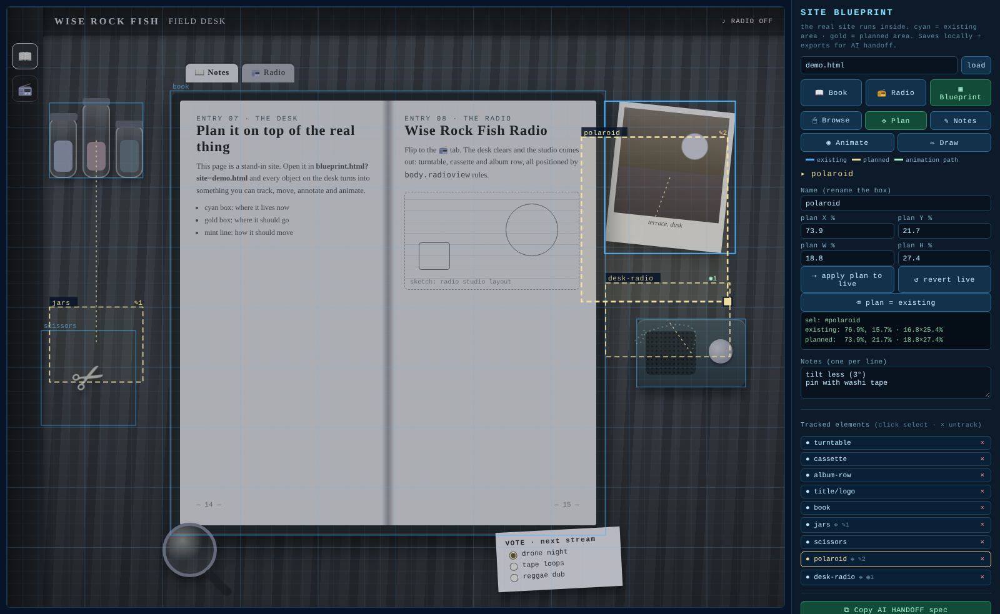
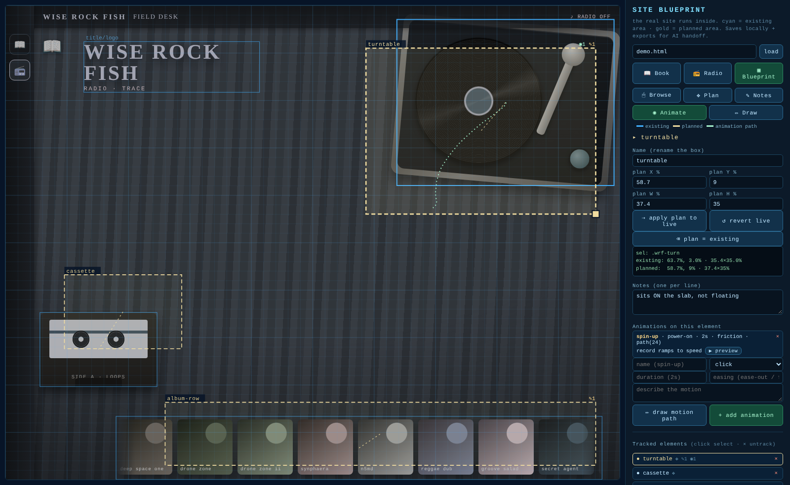
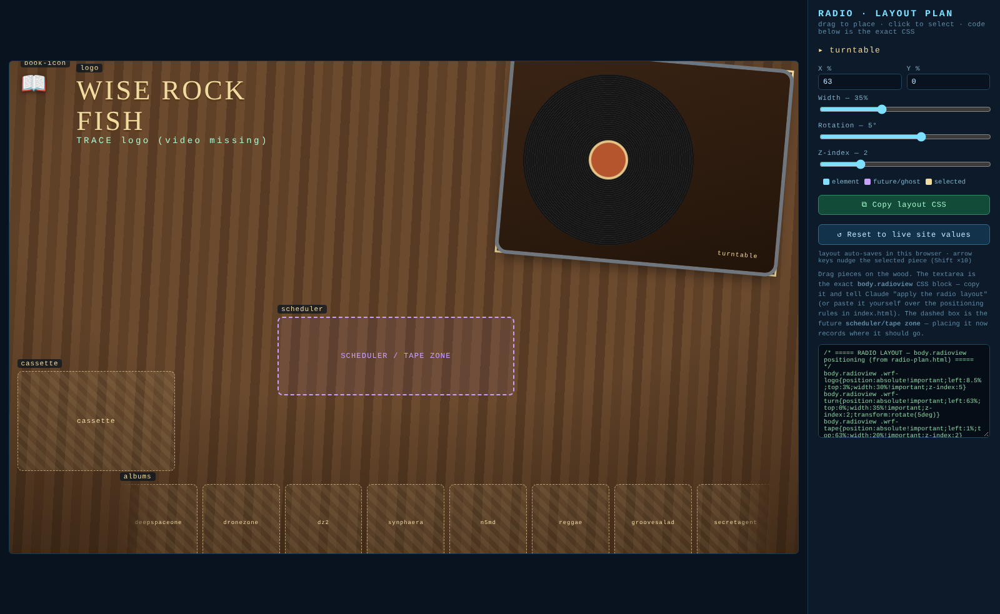
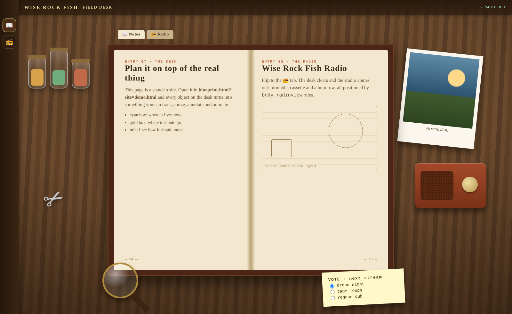
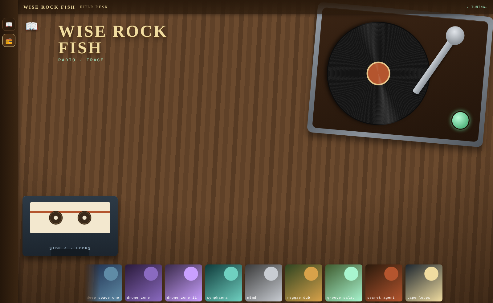
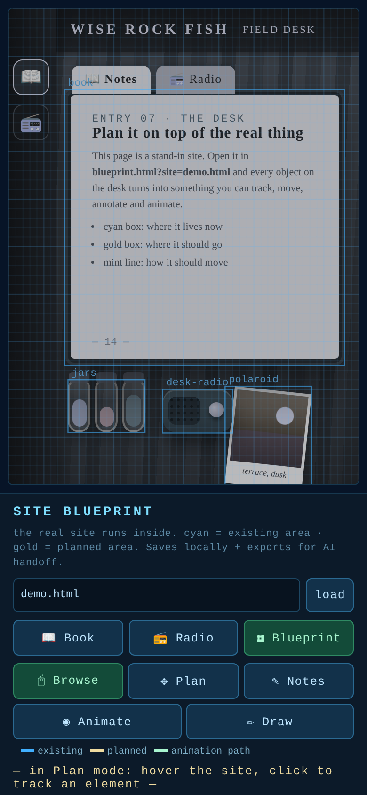
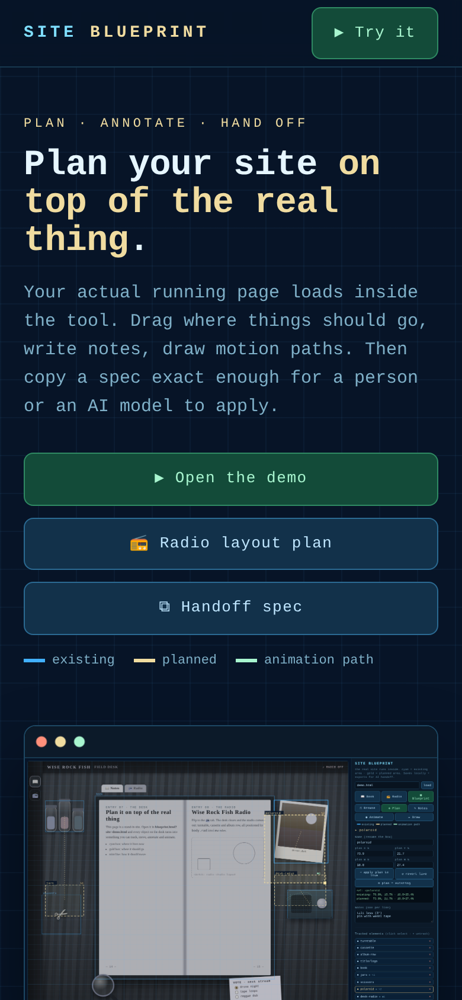

# Site Blueprint: a visual plan-and-code tool for any website

Load your **real, running website** inside the tool and plan changes **on top of it**. Then export
a spec precise enough for a human or an AI model to apply exactly.

No framework, no build, no dependencies. The tool itself is **one HTML file** (`blueprint.html`) plus
its handoff contract (`BLUEPRINT-README.md`). It works on any page served from the same origin.



## Quick start

```bash
npm start            # zero-dependency static server → http://localhost:8803/
# or
python3 -m http.server 8803
```

| Open | What you get |
|---|---|
| http://localhost:8803/ | Project home page (`index.html`) |
| http://localhost:8803/blueprint.html?site=demo.html | The tool, planning the bundled demo desk |
| http://localhost:8803/radio-plan.html | The radio-view layout editor |
| http://localhost:8803/demo.html | The demo page on its own (📻 tab = radio view) |

**On your own site:** drop `blueprint.html` (and `BLUEPRINT-README.md`) into the site's folder, serve
that folder, and open `blueprint.html`. It plans `index.html` by default, or any page with
`?site=other.html`. You can also type a page name into the box at the top of the panel.

## What it does

- **The real site runs in an iframe**, so the "mockup" is always 100% accurate: it *is* the site.
- **Existing vs Planned**: every tracked element gets a cyan box (where it is now, read live from the
  DOM) and a gold box (where you want it). Drag the gold box, resize it with the corner grip, or nudge
  it with the arrow keys. You can also rename it. A connector line shows the move.
- **Apply / revert live**: push the planned rect onto the real element to preview it in place, then undo
  with one click.
- **Notes**: attach instructions to any element.
- **Animation mode**: give each element's animation a name, trigger (click / hover / power-on / scroll / …),
  duration, easing and description, and **draw the motion path with a pen** right on the page.
  ▶ previews the real element moving along your drawn path (Web Animations API).
- **Draw mode**: freehand pen, arrows and eraser over the whole page, saved per view.
- **Blueprint look**: a toggle for a blue tint plus an engineering grid.
- **AI HANDOFF export**: one click copies a spec (existing rect, planned rect, notes, animation specs,
  motion-path coordinates, raw JSON). It is written so a future AI model can apply the plan with zero
  guessing. The schema and apply rules live in `BLUEPRINT-README.md`.
- **JSON export / import**: download a blueprint, then load it again later or on another machine.

Everything auto-saves to `localStorage` per site.

### Keyboard (with a box selected)

| Key | Action |
|---|---|
| `← ↑ → ↓` | nudge the planned box 0.5% |
| `Shift` + arrows | nudge 5% |
| `Alt` + arrows | resize instead of move |
| `Esc` | deselect |

The radio layout plan supports the same arrow and `Esc` keys.

## Screenshots

| Radio view in the tool | Radio layout plan |
|---|---|
|  |  |
| **Demo desk: book view** | **Demo desk: radio view** |
|  |  |

On a phone the panel stacks under the stage:

 

## Files

| File | Role |
|---|---|
| `blueprint.html` | The tool. Single file, zero deps. |
| `BLUEPRINT-README.md` | The handoff contract: JSON schema v2 and the rules an AI must follow to apply a blueprint. |
| `radio-plan.html` | Smaller sibling: an asset-based drag editor built for the Wise Rock Fish Radio view. It emits `body.radioview` CSS and auto-saves. When the painted assets (`assets/`, `images/`) aren't next to it, it draws stand-ins. |
| `demo.html` | A CSS-only stand-in for the live site that uses every selector documented in the spec (`#book`, `#jars`, `.wrf-turn`, `.wrf-grid`, …). It has a book view and a radio view, with a momentum and friction record spin. |
| `index.html` | Project home page. |
| `scripts/serve.mjs` | Zero-dependency static server (`npm start`). |
| `scripts/check.mjs` | Checks that every inline script parses, local links resolve, and pages have their meta basics (`npm test`). |
| `scripts/screenshots.mjs` | Regenerates `docs/screenshots/` with Playwright (`npm run screenshots`, with the server running). |

## Development

```bash
npm test               # parse + link + meta checks for every page
npm start              # serve on :8803 (or: node scripts/serve.mjs 9000)
npm run screenshots    # needs Playwright available to Node
```

## Limits

Same-origin only (browser security): the tool must be served from the same folder or domain as the
page it plans, because cross-origin pages can't be read. If the page is missing, the tool now shows a
message with a link to the demo instead of a blank stage.
